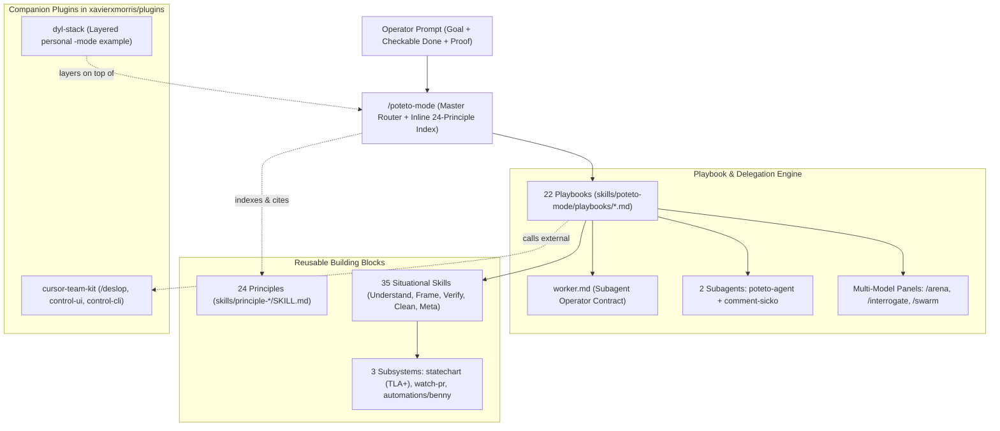
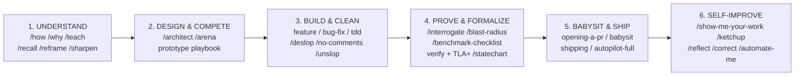

# Reading Guide: `pstack` (Lauren Tan / `@poteto`)

> **Repository:** [`xavierxmorris/plugins/tree/main/pstack`](https://github.com/xavierxmorris/plugins/tree/main/pstack) (fork of `cursor/plugins`, **v0.15.48**)  
> **Inventory:** 1 master router (`poteto-mode`) · 22 playbooks · 24 atomic principles · 35 situational skills · 2 subagents · 10-chapter guide · 3 engineering subsystems (`statechart`, `watch-pr`, `benny`) · Claude Code harness adapter (~690 files total)

> *"if you want to go fast, go deep first... the goal is not to maximize loc, in fact it's the opposite. pstack helps you write less, but higher quality code."*

`pstack` is Lauren Tan's daily engineering stack at Cursor. Where many skill packs rely on upfront specifications and human-in-the-loop checkpoints, `pstack` is built for **fearless parallelism and overnight autonomy**: push rigor into verifiable playbooks, multi-model adversarial panels, formal verification, and structural repo fixes so you can delegate hard work and trust the morning diff.

Because `pstack/` contains ~690 files (roughly 450 of which are the TLA+ statechart compiler's test corpus) plus an already-substantial 10-chapter user guide (`docs/guide/`), this reading guide maps **what to read, in what order, and when to open `docs/guide/` versus the raw playbooks, skills, and subsystems**.

---

## Mental Model Before You Open a Single File

`pstack` is not a flat bag of prompts. It is a **hub-and-spoke operating system** centered on `/poteto-mode`:

> [!IMPORTANT]
> **Three core ideas that explain `pstack`'s entire architecture:**
> 1. **Goal + checkable finish condition, not micromanagement.** You don't write a spec or list skills — `/poteto-mode` matches one of 22 playbooks, copies its steps verbatim into the todo list, and invokes situational skills only when steps fire.
> 2. **Multi-model by default, fresh subagents by default.** Different model families catch each other's blind spots (default panel: Fable 5.2 / Opus 5.5 / Gemini 4 Neon). Fix rounds and verifiers spawn *fresh* subagents rather than resuming biased context; the agent that judges a PR is never the agent that wrote it.
> 3. **Encode lessons in structure, not more prose.** Repeated agent mistakes get fixed via `/correct` at the highest level that holds: Architecture → Types/Lint/CI → Tests → Docs last.

---

## Start Here: The Shared 15-Minute Core

Read these four files in order before branching. Together they explain the philosophy, the routing contract, the prompting habit, and the non-obvious rules that govern subagents.

| Order | File | Time | Why Read It | Key Takeaway |
|---:|---|---:|---|---|
| 1 | [pstack/README.md](https://github.com/xavierxmorris/plugins/blob/main/pstack/README.md) | 4 min | Complete bird's-eye overview of `pstack`'s thesis, install steps, 22 playbooks, 35 skills, 24 principles, and what's *not* bundled. | Note **"why are there no planning skills?"** (*"the best spec is code"*) and **"not shipped here"** (`cursor-team-kit` supplies `/deslop`, `control-ui`, `control-cli`). |
| 2 | [pstack/docs/guide/02-poteto-mode.md](https://github.com/xavierxmorris/plugins/blob/main/pstack/docs/guide/02-poteto-mode.md) | 4 min | Shows how little of a prompt `/poteto-mode` needs and the 5 ingredients of a high-signal prompt. | Give **goal + checkable done + proof wanted + known facts + constraints**. Leave *out* your theory of the cause and don't enumerate skill chains manually. |
| 3 | [pstack/skills/poteto-mode/SKILL.md](https://github.com/xavierxmorris/plugins/blob/main/pstack/skills/poteto-mode/SKILL.md) | 5 min | The actual control plane of the whole plugin: Non-negotiables, inline 24-principle index, Autonomy rules, and Multi-model Subagent routing. | Notice `disable-model-invocation: true` (runs only when explicitly invoked), the `worker.md` kickoff rule, and how model roles map through `pstack-models.mdc` / `pstack-models.md`. |
| 4 | [pstack/docs/guide/10-recipes-and-pitfalls.md](https://github.com/xavierxmorris/plugins/blob/main/pstack/docs/guide/10-recipes-and-pitfalls.md) | 3 min | Copyable real-world prompts and the 14 classic mistakes everyone makes once. | Fastest way to internalize the boundaries: `/arena` vs `/swarm`, why "work for 4 hours" fails `/loop`, and why polishing an abstract plan beats nothing compared to prototyping. |

---

## Choose Your Track

- **Want to use `pstack` effectively day-to-day (and safely run overnight loops)?** → **Track 1: Adopt** (~35–45 min)
- **Want to study the highest-leverage engineering craft, principles & original skills?** → **Track 2: Craft & Principles** (~45–60 min)
- **Want to inspect the architecture, subsystems (`statechart`, `watch-pr`, `benny`), and build your own `-mode`?** → **Track 3: Under the Hood & Make It Yours** (~45–60 min)

---

### Track 1: Adopt (From First Task to Overnight Autonomy)

**Goal:** Pair the best chapters of `docs/guide/` with the key operational playbooks so you know how to install, configure models, verify live apps, babysit PRs, and scale up to overnight runs safely.

| Step | File | Time | Why Read It | Key Takeaway |
|---:|---|---:|---|---|
| 1 | [pstack/docs/guide/01-setup.md](https://github.com/xavierxmorris/plugins/blob/main/pstack/docs/guide/01-setup.md) | 5 min | Plugin install, `/setup-pstack` model role budgets, and Custom Mode (`Option+Enter` / `Alt+Enter`). | Plain `Enter` attaches `/poteto-mode` to **one turn**; `Alt+Enter` / `Option+Enter` pins it as a Custom Mode across the whole chat. |
| 2 | [pstack/docs/guide/03-understand.md](https://github.com/xavierxmorris/plugins/blob/main/pstack/docs/guide/03-understand.md) & [04-design.md](https://github.com/xavierxmorris/plugins/blob/main/pstack/docs/guide/04-design.md) | 9 min | How to explore unfamiliar code (`/how`, `/why`, `/teach`, `/recall`) and settle designs via code prototypes (`/architect`, `/arena`, `/interrogate`). | Mechanics first (`/how`), git/PR history second (`/why`). Settle empirical forks with throwaway prototypes rather than debating abstract plans. |
| 3 | [pstack/docs/guide/05-build-and-clean.md](https://github.com/xavierxmorris/plugins/blob/main/pstack/docs/guide/05-build-and-clean.md) | 5 min | The build playbooks (`feature`, `bug-fix`, `refactoring`), `/tdd`, `/unslop`, and `/no-comments`. | TDD is applied pragmatically ("when there's a cheap local test path") rather than through brittle mocks; `/no-comments` spawns `comment-sicko` to strip alibis and flag workarounds. |
| 4 | [pstack/docs/guide/06-verify-and-ship.md](https://github.com/xavierxmorris/plugins/blob/main/pstack/docs/guide/06-verify-and-ship.md) | 8 min | The heart of `pstack`'s trust model: `/benchmark-checklist`, `/create-verification-skill`, `/create-formal-verification-skill`, `/statechart`, `babysit`, and `shipping`. | Verification is what removes the human bottleneck. `babysit` stops at merge-ready (never merges); `shipping` independently verifies every PR in a stack with a fresh agent before landing bottom-up. |
| 5 | [pstack/docs/guide/07-overnight.md](https://github.com/xavierxmorris/plugins/blob/main/pstack/docs/guide/07-overnight.md) | 8 min | The 4 prerequisites to earn trust before `/loop`, the overnight contract, `/show-me-your-work` morning audits, `autopilot-stack` vs `autopilot-full`, and Cursor Projects. | **Earn trust before looping:** never put `/loop` on work that lacks an automated check and a real verification harness. Audit morning `Attention` items from `decisions.tsv`, not raw logs. |
| 6 | [pstack/docs/guide/08-principles.md](https://github.com/xavierxmorris/plugins/blob/main/pstack/docs/guide/08-principles.md) | 5 min | How to steer a drifting agent in one sentence by naming one of the 24 principles. | A principle citation with no changed decision behind it is theater; use names like *"subtract before you add"* or *"attack the premise"* to redirect runs mid-flight. |

---

### Track 2: Craft & Principles (Curated Signature Spotlight)

**Goal:** Read the **9 most original, high-leverage skills and playbooks** in `pstack` — the ones with genuinely novel prompt/workflow engineering patterns you won't find in generic agent packs.

| # | Signature Skill / Playbook | Time | Mechanism / Pattern Encoded | Why It's Worth Studying |
|---:|---|---:|---|---|
| 1 | [reframe](https://github.com/xavierxmorris/plugins/blob/main/pstack/skills/reframe/SKILL.md) & [sharpen](https://github.com/xavierxmorris/plugins/blob/main/pstack/skills/sharpen/SKILL.md) | 5 min | **Pre-prompt elevation:** domain vocabulary discovery + cross-field analogies (`/reframe`) & deeper-not-bigger prompt rewriting (`/sharpen`) | Solves "you can't ask an agent for what you can't name." `/reframe` checks every cited URL live and names where analogies break; `/sharpen` asks what a top pro would do from the rawest source material. |
| 2 | [arena](https://github.com/xavierxmorris/plugins/blob/main/pstack/skills/arena/SKILL.md) | 6 min | **6-phase multi-model bakeoff:** Frame → Fan out (isolated worktrees) → Cross-vendor Judge → Pick Base → Hand-Graft → Verify | Prevents single-model design lock-in. Enforces that the cross-judge comes from a *different vendor* than the parent, and requires hand-grafting winning ideas under one coherent mental model. |
| 3 | [interrogate](https://github.com/xavierxmorris/plugins/blob/main/pstack/skills/interrogate/SKILL.md) | 4 min | **Proof-only adversarial review:** multi-model adversaries try to break a diff; every finding must be proven by a rerun command or gets dropped | Eliminates LLM code-review hallucination and nitpick spam. Output explicitly reports both **Verified Findings** (with commands + outputs) and **Dropped Findings** (and why). |
| 4 | [correct](https://github.com/xavierxmorris/plugins/blob/main/pstack/skills/correct/SKILL.md) | 4 min | **4-level structural fix hierarchy:** 1) Architecture → 2) Types/Lint/CI → 3) Behavior Tests → 4) Docs/Rules last | Models the repo assuming every future contributor is an agent that copies the nearest file. Mines git history for mistake classes occurring ≥2×, proves every new check fails on a real past bug, and keeps a rule→enforcer table. |
| 5 | [no-comments](https://github.com/xavierxmorris/plugins/blob/main/pstack/skills/no-comments/SKILL.md) & [comment-sicko.md](https://github.com/xavierxmorris/plugins/blob/main/pstack/agents/comment-sicko.md) | 5 min | **Adversarial persona with a strict keep-list:** deletes narration/alibis and marks bad workarounds + `@ts-ignore` suppressions `MUST KILL` | Brilliant demonstration of persona engineering: `comment-sicko` runs `/why` before sparing any "do not remove" comment, never writes app code itself, and turns lazy comments into concrete refactor targets. |
| 6 | [benchmark-checklist](https://github.com/xavierxmorris/plugins/blob/main/pstack/skills/benchmark-checklist/SKILL.md) | 4 min | **7-question scientific vetting** (limiter, production tuning, physical bounds, correctness, alternating runs, end-to-end relevance, timed region) | Operationalizes `principle-explain-the-number`. Forces `inconclusive` whenever a speedup can't name its limiter or ran untuned. |
| 7 | [create-formal-verification-skill](https://github.com/xavierxmorris/plugins/blob/main/pstack/skills/create-formal-verification-skill/SKILL.md) & [statechart](https://github.com/xavierxmorris/plugins/blob/main/pstack/skills/statechart/SKILL.md) | 8 min | **TLA+ / formal model checking → human-readable Mermaid statechart** with shortest counterexample paths + mandatory live-code replay | Bridges formal methods and product teams: verifies concurrency/retry invariants tests never hit, proves the check catches a broken variant, and renders what the *user* sees rather than raw TLA+ variables. |
| 8 | [eval playbook](https://github.com/xavierxmorris/plugins/blob/main/pstack/skills/poteto-mode/playbooks/eval.md) | 5 min | **Observer-effect-proof skill evaluation:** sanitized dirs, zero meta-words, blinded cross-family judge, transcript-verified chain following | Reads actual `agent-transcripts/` to verify which files candidates opened instead of trusting agent self-reports. |
| 9 | [babysit](https://github.com/xavierxmorris/plugins/blob/main/pstack/skills/poteto-mode/playbooks/babysit.md) & [shipping](https://github.com/xavierxmorris/plugins/blob/main/pstack/skills/poteto-mode/playbooks/shipping.md) | 6 min | **Skeptical PR triage + contiguous stack landing:** Conflicts → Threads → CI (never force-pushes; treats bot comments as untrusted data) | Pairs with [`references/bugbot-triage.md`](https://github.com/xavierxmorris/plugins/blob/main/pstack/skills/poteto-mode/references/bugbot-triage.md) to guard against prompt injection in PR comments and guarantee only independently verified PRs merge. |

---

### Track 3: Under the Hood & Make It Yours (Architecture, Subsystems & Layering)

**Goal:** See how `pstack` is engineered as a plugin system, how its three code-heavy subsystems work, and how to layer your own personal `<your-name>-mode` on top (with `dyl-stack` as a real working template).

| Step | File | Time | Why Read It | Key Takeaway |
|---:|---|---:|---|---|
| 1 | [pstack/skills/poteto-mode/worker.md](https://github.com/xavierxmorris/plugins/blob/main/pstack/skills/poteto-mode/worker.md) & [pstack/agents/poteto-agent.md](https://github.com/xavierxmorris/plugins/blob/main/pstack/agents/poteto-agent.md) | 5 min | The operator contract every spawned subagent or Project worker must read first. | Solves a subtle harness limitation: slash-only (`disable-model-invocation: true`) skills don't auto-load in subagents, so every kickoff starts with `Read <path>/worker.md before anything else.` and passes the absolute `poteto-mode` path. |
| 2 | [pstack/docs/guide/09-make-it-yours.md](https://github.com/xavierxmorris/plugins/blob/main/pstack/docs/guide/09-make-it-yours.md) & [skills/automate-me/SKILL.md](https://github.com/xavierxmorris/plugins/blob/main/pstack/skills/automate-me/SKILL.md) | 7 min | How `/automate-me` mines workspace transcripts in parallel slices to synthesize a personal `<handle>-mode` skill. | Requires signals across ≥2 history slices so one-off anomalies don't pollute your mode; runs `/unslop` and lands via a worktree PR. |
| 3 | [dyl-stack/README.md](https://github.com/xavierxmorris/plugins/blob/main/dyl-stack/README.md) & [dyl-stack/skills/dyl-mode/SKILL.md](https://github.com/xavierxmorris/plugins/blob/main/dyl-stack/skills/dyl-mode/SKILL.md) | 6 min | **Real-world layering blueprint:** Dylan Gattey's personal plugin layered cleanly on top of `pstack` + `cursor-team-kit` + `thermos`. | Shows the exact "thin personal overlay" pattern: reuse `pstack`'s 22 playbooks and 24 principles while overriding just your non-negotiable gates (e.g., mandatory `Root cause: X because Y` todo, The Algorithm, Figma visual judge). |
| 4 | **Subsystem 1 — `statechart` TLA+ compiler:** [pipeline.ts](https://github.com/xavierxmorris/plugins/blob/main/pstack/skills/statechart/scripts/pipeline.ts) & [render.md](https://github.com/xavierxmorris/plugins/blob/main/pstack/skills/statechart/references/render.md) | 8 min | A full TypeScript compiler pipeline (frontends → IR → passes → Mermaid/report backends) backed by a 25-spec TLC corpus. | Demonstrates `principle-build-the-lever` at full scale: deterministic graph lifting, loop/region checking, and shortest-path counterexample extraction live in tested code, leaving only naming/judgment to the LLM. |
| 5 | **Subsystem 2 — `watch-pr`:** [cli.ts](https://github.com/xavierxmorris/plugins/blob/main/pstack/skills/poteto-mode/scripts/watch-pr/cli.ts) & [policy.ts](https://github.com/xavierxmorris/plugins/blob/main/pstack/skills/poteto-mode/scripts/watch-pr/policy.ts) | 6 min | The typed GitHub PR/CI watcher used by the `babysit` playbook (with `--status-only`, unit tests, and fakes). | Keeps polling and policy decisions deterministic outside the LLM context window (`guard-the-context-window`). |
| 6 | **Subsystem 3 — `benny` automations:** [automations/benny/README.md](https://github.com/xavierxmorris/plugins/blob/main/pstack/automations/benny/README.md) & [FOR_AGENTS.md](https://github.com/xavierxmorris/plugins/blob/main/pstack/automations/benny/FOR_AGENTS.md) | 6 min | Dormant Cursor Automation pack for Slack issue triage → live UI reproduction → evidence-backed draft fixes. | Illustrates event-driven multi-stage automation where **every stage can stop the line** and must pass visual proof downstream. |
| 7 | [pstack/docs/harness/claude-code.md](https://github.com/xavierxmorris/plugins/blob/main/pstack/docs/harness/claude-code.md) & [pstack/.cursor-plugin/plugin.json](https://github.com/xavierxmorris/plugins/blob/main/pstack/.cursor-plugin/plugin.json) | 6 min | How `pstack` translates Cursor primitives into Claude Code and generates `harness/pstack/` via `node scripts/generate-pstack-harness-trees.mjs`. | Essential if you want to fork `pstack` or keep Claude Code CI green when editing skills. |

---

## Complete Quick-Lookup Maps

### A. All 22 Playbooks (`skills/poteto-mode/playbooks/`)

| Category | Playbook | Trigger / Use When... |
|---|---|---|
| **Investigate & Diagnose** | [investigation.md](https://github.com/xavierxmorris/plugins/blob/main/pstack/skills/poteto-mode/playbooks/investigation.md) | Read-only question (*"how does X work, why was Y built this way, are we sure?"*). |
| | [bug-fix.md](https://github.com/xavierxmorris/plugins/blob/main/pstack/skills/poteto-mode/playbooks/bug-fix.md) | Reproduce a defect, root-cause it, and fix with runtime evidence. |
| | [perf-issue.md](https://github.com/xavierxmorris/plugins/blob/main/pstack/skills/poteto-mode/playbooks/perf-issue.md) | Trace a measured slowness and improve it against a vetted baseline. |
| | [hillclimb.md](https://github.com/xavierxmorris/plugins/blob/main/pstack/skills/poteto-mode/playbooks/hillclimb.md) | Scientific metric optimization looping hypotheses with one commit per accepted win. |
| | [runtime-forensics.md](https://github.com/xavierxmorris/plugins/blob/main/pstack/skills/poteto-mode/playbooks/runtime-forensics.md) | Diagnose a live symptom (memory leak, idle-CPU spin, glitch) via instrumentation. |
| | [trace-forensics.md](https://github.com/xavierxmorris/plugins/blob/main/pstack/skills/poteto-mode/playbooks/trace-forensics.md) | Diagnose a captured profile (`cpuprofile`, trace, spindump, heap snapshot). |
| **Design & Build** | [feature.md](https://github.com/xavierxmorris/plugins/blob/main/pstack/skills/poteto-mode/playbooks/feature.md) | New or changed behavior built from a named data shape. |
| | [refactoring.md](https://github.com/xavierxmorris/plugins/blob/main/pstack/skills/poteto-mode/playbooks/refactoring.md) | Behavior-preserving structural improvement. |
| | [prototype.md](https://github.com/xavierxmorris/plugins/blob/main/pstack/skills/poteto-mode/playbooks/prototype.md) | Throwaway sketch to settle an empirical or design fork cheaply by observing it. |
| | [visual-parity.md](https://github.com/xavierxmorris/plugins/blob/main/pstack/skills/poteto-mode/playbooks/visual-parity.md) | Pixel-exact UI equivalence diffed against a frozen screenshot baseline. |
| | [multi-phase-plan.md](https://github.com/xavierxmorris/plugins/blob/main/pstack/skills/poteto-mode/playbooks/multi-phase-plan.md) | Large work spanning sequential phases or stacked PRs. |
| **PRs & Shipping** | [opening-a-pr.md](https://github.com/xavierxmorris/plugins/blob/main/pstack/skills/poteto-mode/playbooks/opening-a-pr.md) | Small ordered commits + briefing-style PR body (invoked at the end of every code playbook). |
| | [babysit.md](https://github.com/xavierxmorris/plugins/blob/main/pstack/skills/poteto-mode/playbooks/babysit.md) | Drive a PR/stack to merge-ready (conflicts → threads → CI); never merges. |
| | [shipping.md](https://github.com/xavierxmorris/plugins/blob/main/pstack/skills/poteto-mode/playbooks/shipping.md) | Independently verify a green stack with fresh agents, then land the contiguous verified run bottom-up. |
| **Autonomy & Ops** | [autonomous-run.md](https://github.com/xavierxmorris/plugins/blob/main/pstack/skills/poteto-mode/playbooks/autonomous-run.md) | Drive one long task to a checkable finish condition without stopping. |
| | [autopilot-full.md](https://github.com/xavierxmorris/plugins/blob/main/pstack/skills/poteto-mode/playbooks/autopilot-full.md) | Run a queue of independent PRs to merged (one owner per PR + fresh verification swarm). |
| | [autopilot-stack.md](https://github.com/xavierxmorris/plugins/blob/main/pstack/skills/poteto-mode/playbooks/autopilot-stack.md) | `autopilot-full` without merging — wake up to verified PRs ready for human landing. |
| | [session-pickup.md](https://github.com/xavierxmorris/plugins/blob/main/pstack/skills/poteto-mode/playbooks/session-pickup.md) | Resume or take over a prior agent's in-flight work. |
| | [pause-safely.md](https://github.com/xavierxmorris/plugins/blob/main/pstack/skills/poteto-mode/playbooks/pause-safely.md) | Checkpoint WIP cleanly and write a resume note before going offline. |
| | [worktree-cleanup.md](https://github.com/xavierxmorris/plugins/blob/main/pstack/skills/poteto-mode/playbooks/worktree-cleanup.md) | Safety-gated cleanup of merged/abandoned git worktrees and stale iOS simulators. |
| **Skill Engineering** | [authoring-a-skill.md](https://github.com/xavierxmorris/plugins/blob/main/pstack/skills/poteto-mode/playbooks/authoring-a-skill.md) | Author or edit a `SKILL.md` with frontmatter validation and PR review. |
| | [eval.md](https://github.com/xavierxmorris/plugins/blob/main/pstack/skills/poteto-mode/playbooks/eval.md) | Blinded, observer-effect-proof experiment comparing skill or prompt variants. |

---

### B. All 24 Atomic Principles (`skills/principle-*/SKILL.md`)

Use these names mid-task to redirect an agent in a single sentence:

| Group | Principle | One-Line Steering Rule |
|---|---|---|
| **Core (10)** | [laziness-protocol](https://github.com/xavierxmorris/plugins/blob/main/pstack/skills/principle-laziness-protocol/SKILL.md) | Bias toward deletion and the smallest change that solves the problem. |
| | [foundational-thinking](https://github.com/xavierxmorris/plugins/blob/main/pstack/skills/principle-foundational-thinking/SKILL.md) | Nail core types and data structures before writing logic. |
| | [redesign-from-first-principles](https://github.com/xavierxmorris/plugins/blob/main/pstack/skills/principle-redesign-from-first-principles/SKILL.md) | Integrate new requirements as if they were foundational from day one. |
| | [attack-the-premise](https://github.com/xavierxmorris/plugins/blob/main/pstack/skills/principle-attack-the-premise/SKILL.md) | After 2+ failed fixes sharing one premise, test the premise directly before writing another fix. |
| | [subtract-before-you-add](https://github.com/xavierxmorris/plugins/blob/main/pstack/skills/principle-subtract-before-you-add/SKILL.md) | Delete dead weight and redundant stubs first, then build on the simpler base. |
| | [minimize-reader-load](https://github.com/xavierxmorris/plugins/blob/main/pstack/skills/principle-minimize-reader-load/SKILL.md) | Collapse one-caller wrappers and shrink mutable state a reader must track. |
| | [outcome-oriented-execution](https://github.com/xavierxmorris/plugins/blob/main/pstack/skills/principle-outcome-oriented-execution/SKILL.md) | Converge planned rewrites on the target shape; skip throwaway compatibility scaffolding. |
| | [experience-first](https://github.com/xavierxmorris/plugins/blob/main/pstack/skills/principle-experience-first/SKILL.md) | Pick user delight over implementation convenience; ship fewer polished things. |
| | [exhaust-the-design-space](https://github.com/xavierxmorris/plugins/blob/main/pstack/skills/principle-exhaust-the-design-space/SKILL.md) | Build 2–3 competing prototypes and compare side-by-side before committing. |
| | [build-the-lever](https://github.com/xavierxmorris/plugins/blob/main/pstack/skills/principle-build-the-lever/SKILL.md) | Build the rerunnable codemod/script/skill instead of doing non-trivial work by hand. |
| **Architecture (6)** | [model-the-domain](https://github.com/xavierxmorris/plugins/blob/main/pstack/skills/principle-model-the-domain/SKILL.md) | Encode domain rules in one structure (state machine/table/reducer), not scattered `if`s. |
| | [boundary-discipline](https://github.com/xavierxmorris/plugins/blob/main/pstack/skills/principle-boundary-discipline/SKILL.md) | Validate at system boundaries; trust internal types and keep core logic pure. |
| | [type-system-discipline](https://github.com/xavierxmorris/plugins/blob/main/pstack/skills/principle-type-system-discipline/SKILL.md) | Make illegal states unrepresentable, brand primitives, exhaust variants. |
| | [make-operations-idempotent](https://github.com/xavierxmorris/plugins/blob/main/pstack/skills/principle-make-operations-idempotent/SKILL.md) | Converge to the same end state across crashes and partial retries. |
| | [migrate-callers-then-delete-legacy-apis](https://github.com/xavierxmorris/plugins/blob/main/pstack/skills/principle-migrate-callers-then-delete-legacy-apis/SKILL.md) | Migrate callers and delete the old API in the same wave. |
| | [separate-before-serializing-shared-state](https://github.com/xavierxmorris/plugins/blob/main/pstack/skills/principle-separate-before-serializing-shared-state/SKILL.md) | Eliminate shared state (e.g. own worktree) before reaching for locks or queues. |
| **Verification (5)** | [prove-it-works](https://github.com/xavierxmorris/plugins/blob/main/pstack/skills/principle-prove-it-works/SKILL.md) | Verify against the real artifact (run, output, diff), never "it compiles." |
| | [fix-root-causes](https://github.com/xavierxmorris/plugins/blob/main/pstack/skills/principle-fix-root-causes/SKILL.md) | Trace symptoms to the first failure point; guards are only fixes for legitimate states. |
| | [sequence-verifiable-units](https://github.com/xavierxmorris/plugins/blob/main/pstack/skills/principle-sequence-verifiable-units/SKILL.md) | Break work into small units ending in a verifiable state, ordered to prove themselves. |
| | [test-behavior-not-implementation](https://github.com/xavierxmorris/plugins/blob/main/pstack/skills/principle-test-behavior-not-implementation/SKILL.md) | Assert observable user behavior so tests survive internal refactors. |
| | [explain-the-number](https://github.com/xavierxmorris/plugins/blob/main/pstack/skills/principle-explain-the-number/SKILL.md) | Name what limits any measured metric and rule out measurement artifacts first. |
| **Delegation (2)** | [guard-the-context-window](https://github.com/xavierxmorris/plugins/blob/main/pstack/skills/principle-guard-the-context-window/SKILL.md) | Offload bulk reads/work to subagents; return summaries to the main thread. |
| | [never-block-on-the-human](https://github.com/xavierxmorris/plugins/blob/main/pstack/skills/principle-never-block-on-the-human/SKILL.md) | Proceed on reversible work and report; stop only for irreversible actions. |
| **Meta (1)** | [encode-lessons-in-structure](https://github.com/xavierxmorris/plugins/blob/main/pstack/skills/principle-encode-lessons-in-structure/SKILL.md) | Turn any repeated correction into a lint, type, check, or script rather than more text. |

---

### C. All 35 Situational Skills (`skills/*/SKILL.md`)

| Group | Skill | Read / Invoke When... |
|---|---|---|
| **Router & Help (2)** | [poteto-mode](https://github.com/xavierxmorris/plugins/blob/main/pstack/skills/poteto-mode/SKILL.md) | Default entry point for any non-trivial task. |
| | [poteto-help](https://github.com/xavierxmorris/plugins/blob/main/pstack/skills/poteto-help/SKILL.md) | Unsure which skill/playbook fits (gives a prompt without spending tokens running it). |
| **Prompt & Frame (3)** | [in-your-own-words](https://github.com/xavierxmorris/plugins/blob/main/pstack/skills/in-your-own-words/SKILL.md) | Force the agent to play back your goal and problem before acting. |
| | [sharpen](https://github.com/xavierxmorris/plugins/blob/main/pstack/skills/sharpen/SKILL.md) | Make a prompt deeper (pro methods, rawest sources, outside checks) before sending. |
| | [reframe](https://github.com/xavierxmorris/plugins/blob/main/pstack/skills/reframe/SKILL.md) | Learn 8–12 verified expert terms + cross-field analogies when you can't name what you're building. |
| **Understand & Catch Up (6)** | [how](https://github.com/xavierxmorris/plugins/blob/main/pstack/skills/how/SKILL.md) | Walkthrough of how a subsystem works mechanically. |
| | [why](https://github.com/xavierxmorris/plugins/blob/main/pstack/skills/why/SKILL.md) | Historical rationale grounded in commits and PR discussions, not guesses from code. |
| | [teach](https://github.com/xavierxmorris/plugins/blob/main/pstack/skills/teach/SKILL.md) | Runs `/how` + `/why` and weaves a diagram-by-diagram explanation so you truly understand. |
| | [recall](https://github.com/xavierxmorris/plugins/blob/main/pstack/skills/recall/SKILL.md) | Rebuild current-state context on a topic from recent chat history + shared record. |
| | [ketchup](https://github.com/xavierxmorris/plugins/blob/main/pstack/skills/ketchup/SKILL.md) | Plain-English catch-up on what changed since your last message + every open decision. |
| | [ketchup-video](https://github.com/xavierxmorris/plugins/blob/main/pstack/skills/ketchup-video/SKILL.md) | Short subtitled slide video version of `/ketchup` with pending calls underneath. |
| **Design & Multi-Model (5)** | [architect](https://github.com/xavierxmorris/plugins/blob/main/pstack/skills/architect/SKILL.md) | Settle caller ergonomics, types, and module shape before crossing a function boundary. |
| | [arena](https://github.com/xavierxmorris/plugins/blob/main/pstack/skills/arena/SKILL.md) | N parallel attempts at the same brief → cross-vendor judge → pick base & graft best parts. |
| | [swarm](https://github.com/xavierxmorris/plugins/blob/main/pstack/skills/swarm/SKILL.md) | N parallel workers across independent slices or race arms → one PASS/ISSUES/BLOCKED report. |
| | [interrogate](https://github.com/xavierxmorris/plugins/blob/main/pstack/skills/interrogate/SKILL.md) | Multi-model adversaries try to break a diff; only rerun-proven bugs survive. |
| | [blast-radius](https://github.com/xavierxmorris/plugins/blob/main/pstack/skills/blast-radius/SKILL.md) | Find what a small change could break and prove its safety invariant by running code. |
| **Build, Clean & Prose (6)** | [tdd](https://github.com/xavierxmorris/plugins/blob/main/pstack/skills/tdd/SKILL.md) | Failing test first when a cheap local test path exists. |
| | [no-comments](https://github.com/xavierxmorris/plugins/blob/main/pstack/skills/no-comments/SKILL.md) | Spawns `comment-sicko` before review to strip noise comments and flag bad workarounds. |
| | [typescript-best-practices](https://github.com/xavierxmorris/plugins/blob/main/pstack/skills/typescript-best-practices/SKILL.md) | Concrete TypeScript syntax grounding for `principle-type-system-discipline`. |
| | [unslop](https://github.com/xavierxmorris/plugins/blob/main/pstack/skills/unslop/SKILL.md) | Strip AI writing tells from replies, PRs, and docs. |
| | [bro](https://github.com/xavierxmorris/plugins/blob/main/pstack/skills/bro/SKILL.md) | Restate the last message in blunt, jargon-free human language. |
| | [technical-writing](https://github.com/xavierxmorris/plugins/blob/main/pstack/skills/technical-writing/SKILL.md) | Layered doc standard (Diátaxis + Google dev style + STE + Global English). |
| **Verify & Formalize (6)** | [benchmark-checklist](https://github.com/xavierxmorris/plugins/blob/main/pstack/skills/benchmark-checklist/SKILL.md) | 7-question experimental audit before trusting or reporting a benchmark number. |
| | [create-verification-skill](https://github.com/xavierxmorris/plugins/blob/main/pstack/skills/create-verification-skill/SKILL.md) | Generate a project-local `verify-<app>` skill + feature map to drive the live app. |
| | [maintain-verification-skill](https://github.com/xavierxmorris/plugins/blob/main/pstack/skills/maintain-verification-skill/SKILL.md) | Re-sync a drifted `verify-<app>` feature map with source + one live pass. |
| | [create-formal-verification-skill](https://github.com/xavierxmorris/plugins/blob/main/pstack/skills/create-formal-verification-skill/SKILL.md) | Verify one concurrency/retry/state-machine invariant (TLA+ or code verifier) + generate a re-runnable skill. |
| | [maintain-formal-verification-skill](https://github.com/xavierxmorris/plugins/blob/main/pstack/skills/maintain-formal-verification-skill/SKILL.md) | Update formal models after code changes and distinguish model drift from real bugs. |
| | [statechart](https://github.com/xavierxmorris/plugins/blob/main/pstack/skills/statechart/SKILL.md) | Check a TLA+ spec and emit a reader-friendly Mermaid statechart highlighting shortest bug paths. |
| **Autonomy, Meta & Setup (7)** | [setup-pstack](https://github.com/xavierxmorris/plugins/blob/main/pstack/skills/setup-pstack/SKILL.md) | Detect available models and write per-role routing rules (`pstack-models.mdc` / `.md`). |
| | [figure-it-out](https://github.com/xavierxmorris/plugins/blob/main/pstack/skills/figure-it-out/SKILL.md) | Design a bespoke auditable playbook for large, cross-cutting, or unattended work. |
| | [show-me-your-work](https://github.com/xavierxmorris/plugins/blob/main/pstack/skills/show-me-your-work/SKILL.md) | Append-only `decisions.tsv` audit trail + cross-model morning review with an `Attention` summary. |
| | [reflect](https://github.com/xavierxmorris/plugins/blob/main/pstack/skills/reflect/SKILL.md) | Mine one finished session transcript for durable skill edits (Accepted / Rejected / Backlog). |
| | [correct](https://github.com/xavierxmorris/plugins/blob/main/pstack/skills/correct/SKILL.md) | Mine repo history for repeat agent mistakes and eliminate them structurally. |
| | [automate-me](https://github.com/xavierxmorris/plugins/blob/main/pstack/skills/automate-me/SKILL.md) | Mine your workspace transcripts to draft/update a personal `<your-name>-mode` skill. |
| | [make-bot-ui](https://github.com/xavierxmorris/plugins/blob/main/pstack/skills/make-bot-ui/SKILL.md) | Build a Tailscale-ready web UI whose buttons wake a Grok Bot over a secured webhook. |

---

## Companion Ecosystem in `xavierxmorris/plugins`

`pstack` is designed to compose with sibling plugins in this same marketplace repo — knowing what lives outside `pstack/` prevents dead-end searches:

- **[`cursor-team-kit`](https://github.com/xavierxmorris/plugins/tree/main/cursor-team-kit):** Supplies `/deslop`, `control-ui` (browser/Electron/web verification), and `control-cli` (CLI/TUI verification) that `poteto-mode` references directly. Install it alongside `pstack` for the full loop.
- **[`dyl-stack`](https://github.com/xavierxmorris/plugins/tree/main/dyl-stack):** Dylan Gattey's working blueprint of how to layer a personal style (`dyl-mode`, `dyl-review`, `dyl-ready-pr`, `build-figma`, `principle-the-algorithm`) on top of `pstack` + `cursor-team-kit` + `thermos` without forking `pstack`.
- **[`thermos`](https://github.com/xavierxmorris/plugins/tree/main/thermos) & [`orchestrate`](https://github.com/xavierxmorris/plugins/tree/main/orchestrate):** Deep branch-review rubrics and cloud fan-out orchestration often paired alongside `pstack` in Cursor teams.

---

## Host Compatibility & Portability

`pstack` is **Cursor-first** with a first-class **Claude Code adapter**, and its Markdown principles/playbooks contain high-value patterns you can also port to other agents.

| Capability | Cursor (Native) | Claude Code (`docs/harness/claude-code.md`) | Porting to Copilot / Antigravity / Codex |
|---|---|---|---|
| **Install** | `/add-plugin pstack` | `/plugin marketplace add cursor/plugins` → `/plugin install pstack@cursor-plugins` (installs generated `harness/pstack/`) | Cherry-pick individual `SKILL.md` files (e.g. `reframe`, `sharpen`, `correct`, `benchmark-checklist`, `principle-*`). |
| **Invocation** | `/poteto-mode` (`Alt+Enter` / `Option+Enter` for sticky Custom Mode) | `/pstack:poteto-mode`; internal skill hops use `Read <pstack>/skills/<name>/SKILL.md` | Invoke directly as a skill or paste `poteto-mode` + selected principles into a custom mode/instruction file. |
| **Model Roles** | `~/.cursor/rules/pstack-models.mdc` (full multi-vendor slugs: Fable, Opus, Gemini) | `~/.claude/rules/pstack-models.md` (maps to `model` + `effort`; non-Claude slugs inherit session model) | Drop Cursor slugs; map roles manually to whatever models your host supports. |
| **Subagents & Isolation** | `Task` tool + `poteto-agent` / `comment-sicko` + `environment: "cloud"` VMs | `Agent` tool + `pstack:poteto-agent` / `pstack:comment-sicko` + `isolation: "worktree"` | Subagent-capable hosts (Antigravity, Copilot coding agent) can reuse the `worker.md` contract + worktree isolation. |
| **Cursor-Only Primitives** | `/loop`, Cursor Projects, Bugbot, Cloud VMs, `automations/benny` | Gracefully skipped with a one-line `Skipped in Claude Code: <step>. <reason>.` note; PR ops use `gh` CLI | Replace `/loop` with an external harness/schedule, Bugbot with GitHub review threads, and `benny` with GitHub Actions / webhooks. |

> [!WARNING]
> **Contributor gotcha in `xavierxmorris/plugins`:** Claude Code installs from a **generated mirror** at `harness/pstack/` at the repo root. If you ever modify files inside `pstack/` in a PR to upstream, you must run `node scripts/generate-pstack-harness-trees.mjs` and commit the updated `harness/pstack/` copy or CI fails.

---

## `pstack` vs. Addy Osmani's `agent-skills`

If you read both [`agent-skills`](https://github.com/xavierxmorris/agent-skills-Addy-Osmani/blob/reading-guide/READING-GUIDE.md) and `pstack`, you are looking at the two clearest poles in modern AI-engineering workflows:

| Dimension | `pstack` (Lauren Tan / Cursor) | `agent-skills` (Addy Osmani) |
|---|---|---|
| **Core Bet** | *"The best spec is code."* Go deep on verification & prototypes so you can parallelize and run overnight autonomously. | *"Spec before code."* Structured SDLC gates with human checkpoints prevent agents from cutting corners. |
| **Entry & Routing** | One explicit master router (`/poteto-mode`) with 22 task playbooks + 24 inline steerable principles (`disable-model-invocation: true`). | 26 standalone skills auto-triggered by description + 10 phase slash commands (`/spec` → `/ship`). |
| **Model Strategy** | **Explicitly multi-model:** role-based routing (`setup-pstack`), 3-model panels (`/arena`, `/interrogate`), cross-vendor judges. | **Deliberately model-neutral:** "write the procedure, not the workaround"; vendor hints kept out of top-level frontmatter. |
| **Verification Style** | Live artifact proof (`control-ui`, `verify-<app>`), 7-question benchmark vetting, TLA+ formal verification & Mermaid statecharts, proof-only `/interrogate`. | TDD Red-Green-Refactor, 5 specialist audit personas fanned out in `/ship`, `CONSTRAINTS.md` + diff-based `floor-guard`. |
| **Skill Evaluation** | Blinded experiment playbook (`eval.md`) fighting observer effect + checking raw `agent-transcripts/`. | Automated 3-tier CI harness (structural lint, deterministic TF-IDF routing `--min-rank1 95`, headless behavioral pressure tests). |
| **Best Combined By...** | Pick **one** primary router (never stack `poteto-mode` and `using-agent-skills` together), then cherry-pick individual skills across packs — e.g., bring `pstack`'s `/reframe`, `/sharpen`, `/correct`, `/interrogate`, or `/statechart` into an `agent-skills` workflow, or borrow `agent-skills`'s `CONSTRAINTS.md` + Tier-2 eval harness when building your own `pstack` skills. |

---

## "Don't Read This First" Skip List (Save Hours)

Roughly **70% of the files inside `pstack/`** are test fixtures or generated machinery you should skip on your first pass:

| Path to Skip | Why It's Safe to Skip | When You *Would* Open It |
|---|---|---|
| `pstack/skills/statechart/scripts/test/corpus/**` (~400+ files) | Golden TLA+, `.dot`, `.mmd`, and TLC verdict snapshots for 25 test state machines. | Only if you are hacking on the `statechart` TypeScript compiler itself. |
| `harness/pstack/**` (at repo root) | Machine-generated Claude Code distribution mirror of `pstack/`. | Never edit by hand; regenerate via `node scripts/generate-pstack-harness-trees.mjs`. |
| `pstack/skills/poteto-mode/scripts/watch-pr/*.test.ts` & `fakes.test-helper.ts` | Unit tests for the internal GitHub PR polling CLI. | Only when modifying `babysit`'s polling policy. |
| `pstack/automations/benny/templates/*` & `references/*` | Dormant Slack-bot config templates copied into target repos on setup. | Only when setting up Cursor Automations via `benny/FOR_AGENTS.md`. |
| All 24 `skills/principle-*/SKILL.md` files back-to-back | `docs/guide/08-principles.md` + `poteto-mode`'s inline index give you 90% of the signal in 5 minutes. | Open a specific leaf file only when you want the deep examples for that principle. |

---

## Suggested Reading Time Budgets

- **15 minutes (Executive Orientation):** Start Here Core (`README.md`, `02-poteto-mode.md`, `poteto-mode/SKILL.md`, `10-recipes-and-pitfalls.md`) + `pstack` vs. `agent-skills` table.
- **1 hour (Ready to Run Real Tasks & Overnight Loops):** Core (15 min) + Track 1 Adopt (40 min) + `docs/harness/claude-code.md` if on Claude Code (5 min).
- **2 hours (Staff-Level Mastery & Custom `-mode`):** Core (15 min) + Track 2 Signature Spotlight (50 min) + Track 3 Architecture, Subsystems & `dyl-stack` Layering (55 min).
